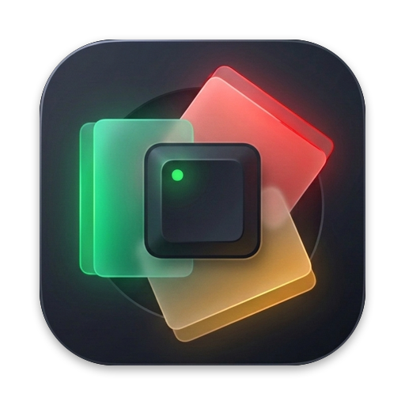
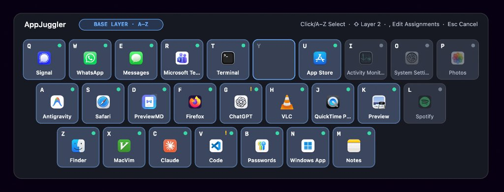
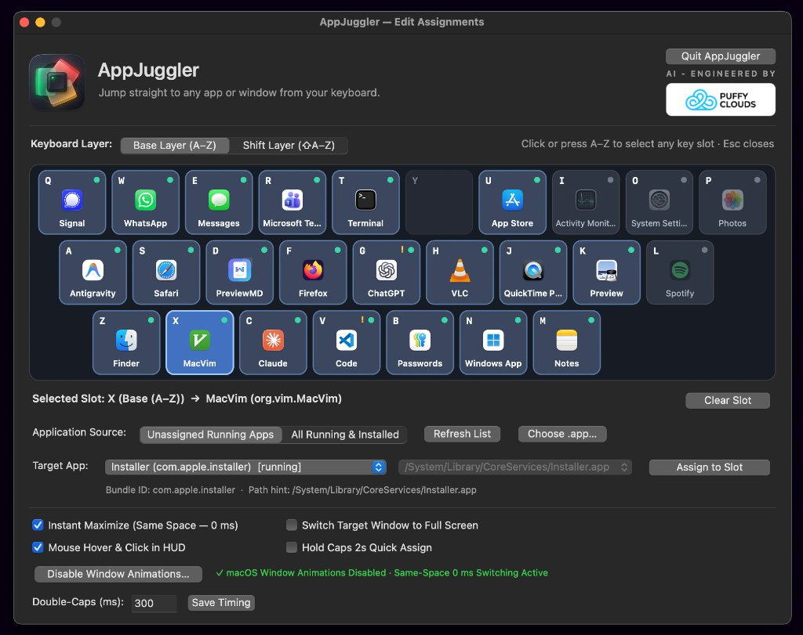

<p align="center">
  
</p>

# AppJuggler

> **Jump straight to any app or window from your keyboard.**

<p align="center">
  
</p>

AppJuggler replaces hunting through `Cmd+Tab`, the Dock, and Mission Control with muscle-memory keyboard addresses:

1. **Double-tap `Caps Lock`** (`Caps Lock ×2`, default `300 ms`) — opens the non-activating keyboard map overlay while naturally restoring your original Caps Lock state and LED.
2. **Press `A–Z` (or `⇧Shift + A–Z`)** — selects one of **52 persistent application slots** (keyed by `bundle_id`, never lost when apps quit or macOS restarts).
3. **Jump immediately or pick a window**:
   - **1 window**: activates immediately — no extra keystroke needed.
   - **Multiple windows / tabs**: press **`1–9`** for slots `1–9` or **`A–Z`** for slots `10–35` (`10 → A`, `11 → B`, …), or **`↑` / `↓` + `Enter`**, or click **`×`** on the right of any row (or press `⌫`) to hide a tab/window from the quick list until you invoke that app on that tab again.
   - **Direct Jump (`~` modifier or per-app setting)**: press **`~`** (`Caps ×2 → ~ → T`) to jump straight to any app's active/MRU window without showing the window/tab list, or uncheck **`Show Window / Tab List`** for specific apps in `Edit Assignments…`.
   - **Closed app**: launches the app asynchronously, observes window creation without fixed `sleep` delays, and activates the target once ready.

Fast sequences such as `Caps ×2 → T → 3` are processed immediately by an O(1) lock-free/microsecond state machine on a dedicated `CGEventTap` thread — you never have to wait for panel animations or window enumeration to finish before typing the chord.

---

## Platform Status

| Platform | Status | Details |
| --- | --- | --- |
| **macOS (13+ / Apple Silicon & Intel)** | **Implemented (MVP Stages 0–4)** | PyObjC (`Quartz` `CGEventTap`, `NSWorkspace`, `AXUIElement`, non-activating `FullScreenAuxiliary` `NSPanel`, menu bar extra, `.app` bundle via `py2app`). |
| **Linux (X11 & Wayland)** | **TODO (Contracts & Stubs Ready)** | Core domain (`NavigationController`, `WindowSlotTable`, `BindingStore`) is 100% OS-independent and tested. OS adapter stubs live in `src/appjuggler/platforms/linux/`; see [docs/linux-roadmap.md](docs/linux-roadmap.md). |

---

## Quickstart from a Clean Checkout (macOS)

### Prerequisites
- macOS 13.0 or newer (validated on macOS 15.7.9, Apple M3 Pro)
- Python 3.11+ (`python3.12` recommended for prebuilt `PyObjC` and `py2app` wheels)

### 1. Set up the virtual environment and install

```bash
git clone https://github.com/xsub/AppJuggler.git
cd AppJuggler
python3.12 -m venv .venv
source .venv/bin/activate
python -m pip install --upgrade pip
python -m pip install -e ".[dev]"
```

### 2. Verify unit tests and system diagnostics

```bash
pytest -v
appjuggler --doctor
```

### 3. Run AppJuggler from the terminal (development mode)

```bash
appjuggler
```

- Look for the compact **keyboard icon** in the macOS menu bar (or press **`Caps Lock ×2 → ,`** anytime if your MacBook camera notch hides overflow menu bar items).
- When running from a terminal, macOS Privacy & Security binds Accessibility permission to **your Terminal / IDE**. Open **`Permissions & Diagnostics…`** from the menu bar icon (or grant your Terminal / IDE directly in **System Settings → Privacy & Security → Accessibility**). AppJuggler detects granted permissions automatically without restarting.
- Out of the box, **`T`** (Base layer) is pre-bound to **Terminal** (`com.apple.Terminal`). Try pressing **`Caps Lock ×2 → T`**!

### 4. Build a standalone `AppJuggler.app` bundle

```bash
./scripts/build_app.sh
open dist/AppJuggler.app
```

- Produces an ad-hoc signed menu-bar bundle (`LSUIElement=true`, `CFBundleIdentifier=io.appjuggler.AppJuggler`) at `dist/AppJuggler.app`.
- Grant **AppJuggler.app** access in **System Settings → Privacy & Security → Accessibility**. (If you rebuild `AppJuggler.app` later, macOS TCC may require toggling its Accessibility switch OFF and back ON.)

---

## Assigning Apps to Keys

### 1. Edit Assignments Window (`Caps ×2 → ,` or Menu Bar Icon)

<p align="center">
  
</p>

- Open **`Edit Assignments…`** anytime from the keyboard by pressing **`Caps Lock ×2 → ,`** *(comma)*, or by clicking the compact keyboard icon in the macOS menu bar.
- Switch between **Base Layer (`A–Z`)** and **Shift Layer (`⇧A–Z`)**, click (or press `A–Z` for) any keycap on the visual keyboard map, select an app from **Unassigned Running Apps** / **All Running & Installed** / **Choose `.app`…**, and click **Assign to Slot**.
- **Instant Maximize (`Same Space — 0 ms`)** *(optional checkbox)*: when checked (or `"auto_maximize_on_switch": true` in `config.json`), any non-modal desktop window AppJuggler switches to instantly fills the screen (`visibleFrame`) via Accessibility API in `< 1 ms` **on the current Desktop Space** — avoiding macOS's cross-Space slide/fade animations completely.
- **Switch Target Window to Full Screen** *(optional checkbox)*: when checked (or `"auto_fullscreen_on_switch": true` in `config.json`), any non-modal target window AppJuggler switches to automatically enters native macOS Full Screen *(note: macOS creates a separate Space per Full Screen window)*.
- **Disable Window Animations…** *(button in `Edit Assignments…` & menu bar)*: opens a dedicated diagnostic & one-click helper window that disables programmable macOS AppKit window, Dock, Mission Control, and Finder animations (`defaults`), moves stuck Full Screen windows onto a single Desktop Space, and links directly to `System Settings → Accessibility → Display → Reduce motion`.
- **Mouse Hover & Click in HUD** *(optional checkbox, disabled by default)*: when checked (or `"enable_mouse_selection": true` in `config.json`), you can also hover to highlight and click to select apps or windows directly in the HUD overlay (plus scroll wheel in multi-window lists and clicking the layer pill to toggle `Base` ↔ `Shift`). When unchecked, the HUD remains keyboard-only and completely click-through (`ignoresMouseEvents`).
- Configuration is stored atomically at `~/Library/Application Support/AppJuggler/config.json` (macOS) or `~/.config/appjuggler/config.json` (Linux), and external edits to `config.json` are hot-reloaded automatically.

### 2. Optional: Hold `Caps Lock` (2s) Quick Assign *(Disabled by Default)*
By default, AppJuggler only runs its lightweight `CGEventTap` double-Caps listener and does **not** attach an `IOHIDManager` hold monitor. If you want a 2-second physical `Caps Lock` hold to open an in-HUD open-apps quick-assign picker, opt in via either:
- Checking **`Hold Caps 2s Quick Assign`** in **`Edit Assignments…`**, or
- Setting `"enable_caps_hold_assign": true` under `"trigger"` in `config.json`:
  ```json
  "trigger": {
    "kind": "double_caps_lock",
    "interval_ms": 300,
    "enable_caps_hold_assign": true,
    "hold_assign_ms": 2000
  }
  ```

---

## Stage 0 System Probes

```bash
# Measure live Caps Lock flagsChanged toggles and double-tap intervals (ms)
.venv/bin/python scripts/probe_caps.py --seconds 15

# Inspect displays, running regular apps, duplicate-bundle conflicts, and AX windows across Spaces
.venv/bin/python scripts/probe_windows.py --all-apps
```

---

## Documentation

- [docs/ARCHITECTURE.md](docs/ARCHITECTURE.md) — Cross-platform architecture, state machine invariants, and real-time threading model
- [docs/macos-validation.md](docs/macos-validation.md) — Empirical macOS 15.7.9 validation results, Spaces/Fullscreen behavior, and known public-API boundaries
- [docs/linux-roadmap.md](docs/linux-roadmap.md) — Architecture and implementation plan for Linux (X11 & Wayland) adapters
- [docs/PROJECT_HANDOFF.md](docs/PROJECT_HANDOFF.md) — Original Polish product & engineering specification
