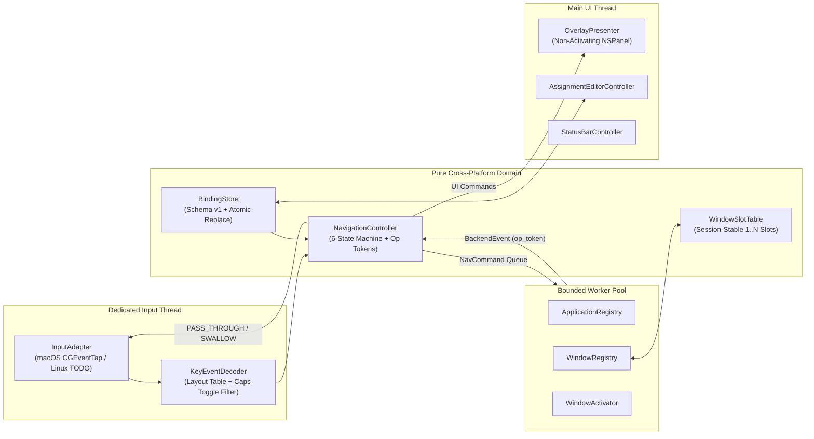

# AppJuggler Architecture

AppJuggler strictly separates **pure navigation logic** from **OS windowing & input integration** so that keyboard responsiveness is deterministic, testable without mocks of WindowServer, and portable across macOS and Linux.

---

## 1. Logical States (`NavigationController`)

Defined in `src/appjuggler/domain/state_machine.py`:

| State | Responsibility |
| --- | --- |
| `Idle` | Watches only for two genuine Caps Lock state-toggling actuations within `interval_ms` (`300 ms`). Never blocks or delays Caps Lock. *(Optional opt-in: if `trigger.enable_caps_hold_assign` is enabled, also accepts `CapsHoldTriggered`.)* |
| `AppSelection` | Modal keyboard capture active. Holding `Shift` previews `Layer.SHIFT`; releasing restores `Layer.BASE`. Pressing `A–Z` locks in the active layer at `keyDown` (ignoring Caps Lock state) and advances immediately. Pressing `,` opens **Edit Assignments…**. |
| `QuickAssignApp` | *(Optional — disabled unless `trigger.enable_caps_hold_assign = true`)* Lists open `Regular` applications for in-HUD quick assignment. |
| `QuickAssignKey` | *(Optional — disabled unless `trigger.enable_caps_hold_assign = true`)* Interactive keyboard map for committing quick assignment. |
| `WindowSelection` | Buffers fast `1–9`, `↑`/`↓`, and `Enter` inputs while window discovery (`resolving=True`) is in flight, then replays them as soon as `AppWindowsResolved` arrives. Once resolved, `↑`/`↓` move highlight without activating, `Enter` activates the highlighted slot, `1–9` jump directly to slot `#1..#9`, and `Esc` cancels. |
| `LaunchPending` | Target app is closed; launches asynchronously while buffering optional preselected window inputs (`1–9` / arrows) and allowing instant `Esc` cancellation via `op_token`. |
| `ActivationPending` | Target window/app activation is executing on a bounded worker thread; swallows trailing chord keys until focus is confirmed or a controlled timeout error is reported. |
| `AssignmentEditing` | Entered when **Edit Assignments…** is open; suspends the double-Caps and 2s Caps-hold triggers so configuration never mixes with live target navigation. |

---

## 2. Key Latency & Safety Invariants

1. **Zero Blocking in the Event Tap Callback**:
   - `MacOSInputAdapter` hosts `CGEventTap` on its own dedicated `CFRunLoop` daemon thread — completely decoupled from AppKit rendering on the main thread.
   - `KeyEventDecoder` translates macOS virtual keycodes to layout-aware base letters (`A–Z`) via an immutable dictionary precomputed on the main thread from Carbon `UCKeyTranslate(modifierKeyState=0)` (refreshed automatically on `TISNotifySelectedKeyboardInputSourceChanged`).
2. **Balanced `keyDown` / `keyUp` Interception**:
   - Every `keycode` whose `keyDown` is swallowed is recorded in `_swallowed_keycodes`.
   - When the panel closes and state returns to `Idle` while the user's finger is still releasing `T` or `3`, the corresponding `keyUp` (and any held auto-repeat) is also swallowed so target apps never receive orphan key releases.
   - Conversely, a `keyUp` for a key pressed *before* opening the panel is passed through so background apps never suffer stuck keys.
3. **Single-Window Trailing Chord Guard**:
   - If an app has only 1 window and a power user reflexively types `Caps ×2 → T → 1` in 80 ms, any buffered digit in `_pending_inputs` is discarded AND a short monotonic chord guard (`150 ms` from the letter `keyDown`) swallows an immediate bare digit `1–9` even if AX finished in 2 ms.
4. **Generation Tracking Against Stale Window Selection**:
   - `WindowSlotTable` increments `generation` whenever an app's set of live `(slot_number, window_id)` pairs changes.
   - If the currently highlighted window closes while viewing the list (`WindowListRefreshed`), `selected_slot` is cleared to `None` with an explicit warning banner so pressing `Enter` cannot accidentally activate a different window (`§10.9`).
   - `MacOSWindowActivator` re-verifies `AXRole` + `AXParent` + PID liveness immediately before raising; if the window closed in the race window after `Enter`, it returns `stale_window=True` and refreshes the list instead of raising another window.
5. **Privacy by Default**:
   - AppJuggler never logs typed characters or full window titles to persistent logs.
